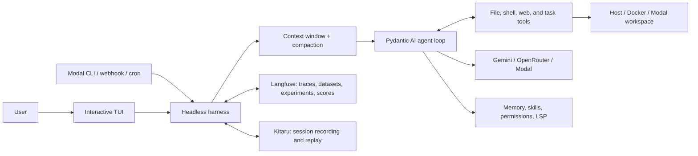

<div align="center">
  <h1>Coding Agent From Scratch</h1>
  <h3>Harness engineering; Claude Code from scratch, from a bare-bones agent loop to a swarm of cloud agents.</h3>
</div>

<p align="center">
  
  
  
</p>

> **Try the finished agent first — 5 minutes, $0:**
>
> ```bash
> git clone https://github.com/HanishDhanwalkar/decode-ollama.git
> cd decode-ollama
> make install
> cp .env.example .env   # set LLM API key
> uv run decode
> ```
>
> Then type `/demo-` and pick a demo. [Full setup guide.](#-running-the-code)

## About This Repo

In [LangChain's Terminal-Bench experiment](https://www.langchain.com/blog/the-anatomy-of-an-agent-harness), changing only the harness (with the same model) moved a coding agent from ~30th place into the top 5: the harness, not the model, is what makes a coding agent good.

### The agent is ~20 lines. The course is everything else, known as the harness

```python
agent = Agent(
    build_model(settings.llm_provider),        # gemini | openrouter | modal
    deps_type=AgentDeps,                       # cwd, event sink, permission gate
    output_type=[str, DeferredToolRequests],   # final answer, or tools paused for approval
)
register_tools(agent)                          # read, edit, bash, grep, ...

async with agent.iter(prompt, message_history=history) as run:
    async for node in run:                     # model request → tool calls → repeat
        stream_events(node)
```

That's the _entire_ tool-calling agent. Everything else in this repo (the tools, skills, permission layer, sandbox, steering queue, memory, compaction, session recording & replay, remote execution, subagent fan-out, and evals) **is the harness**.



<p align="center"><i>The harness architecture of the coding agent </i></p>

### Tech Stack

The code is written in Python, with the following frameworks and libraries:

- **Agent Framework:** [Pydantic AI](https://ai.pydantic.dev)
- **LLM Providers:** [Modal](https://modal.com/docs/guide/endpoints?source=decodingai&campaign=harnesseng) (open weights you serve yourself via SGLang), OpenRouter (open weights as a service), or Gemini (proprietary).
- **Session Recording & Replays:** [Kitaru](https://www.zenml.io/product/kitaru?utm_source=decodingai&utm_medium=referral&utm_campaign=coding-agent-course&utm_content=brand)
- **Tracing, eval orchestration, and trace mining:** [Langfuse](https://langfuse.com)
- **Sandboxing:** local Docker & remote [Modal sandboxes](https://modal.com/docs/guide/sandboxes?source=decodingai&campaign=harnesseng)
- **Deploying:** [Modal](https://modal.com/?source=decodingai&campaign=harnesseng) as headless agents (fired by hand, by cron, or by webhook)

Otherwise, we build all the functionality from scratch to teach you the foundations that last, not frameworks that abstract away the hard parts.

## ⚙️ How It Works

## 🏗️ Project Structure

One Python package; each module maps to one part of the architecture:

```text
.
├── docs/
│   ├── adr/                  # Architecture Decision Records — the "why" of every choice
│   └── glossary.md           # one canonical name per concept
├── evals/                    # benchmark tasks + regression cases + the Langfuse harness
├── scripts/                  # operator scripts: Kitaru bootstrap + eval table generation
├── tests/{unit,integration}/ # mirrors src/ 1:1; milestone capstones prove each milestone
└── src/decode/
    ├── cli.py                # Click entrypoint → launches the TUI
    ├── tui/                  # input: prompt_toolkit · output: Rich
    ├── harness/              # message queue + priority gate around the loop
    ├── agent/                # the Pydantic-AI ReAct loop (LLM ⇄ tools)
    ├── agents/               # agents catalog: Build / Plan / Code-Reviewer + Explore subagent
    ├── tools/                # file I/O, bash, web, todo, skills dispatch, LSP, ask_user
    ├── permissions/          # allow/ask/deny · modes · settings.json
    ├── sandbox/              # bash + file tools seam: none (host) / docker / modal
    ├── services/lsp/         # hand-rolled stdio LSP client (ty)
    ├── runtime/              # plain headless decode run + the Recording Seam
    ├── remote/               # decode remote deploy|run|attempts|logs — the Modal Headless App (CLI, webhook, cron)
    ├── context/              # compaction + conversation log (JSONL)
    ├── memory/               # AGENTS.md / MEMORY.md loading + write-back
    ├── observability/        # Langfuse tracing + evaluation scores
    └── config/, entities/    # settings singleton · shared models
```

## 🚀 Running the Code

The guides live under [`running_the_code/`](running_the_code/). Follow them in order; each ends with a link to the next:

| Guide                                                               | What's inside                                                      |
| ------------------------------------------------------------------- | ------------------------------------------------------------------ |
| [00_troubleshooting.md](running_the_code/00_troubleshooting.md)     | Every known failure, and its fix                                   |
| [01_install_and_usage.md](running_the_code/01_install_and_usage.md) | Start here: install, one key, first session                        |
| [02_modal_endpoints.md](running_the_code/02_modal_endpoints.md)     | Serving open models on Modal                                       |
| [03_sandboxing.md](running_the_code/03_sandboxing.md)               | Docker (local) / Modal (remote) sandboxing + the sandbox git token |
| [04_deploy.md](running_the_code/04_deploy.md)                       | The headless harness on Modal — CLI, webhook, cron                 |
| [05_evals.md](running_the_code/05_evals.md)                         | Benchmarks and regression cases on Langfuse                        |
| [06_evals_replays.md](running_the_code/06_evals_replays.md)         | Kitaru on your laptop: record, replay & the full evals loop        |

## Contributing

Found a bug and know the fix? Fork, fix, run `make ci` (no API key needed), and open a pull request. Future readers will thank you 🤗

## License

Released under [Apache-2.0](LICENSE). Clone, fork, and build on it; keep the LICENSE and credit this repo.
